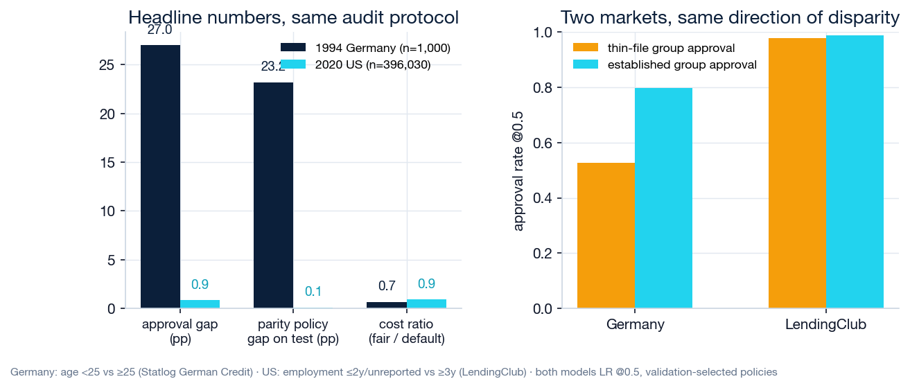

# FairLens — a fairness audit of a loan approval model

**Track:** AI + Finance · **Team:** Hao Tan · **Dataset:** [Statlog German Credit (UCI id=144)](https://archive.ics.uci.edu/dataset/144/statlog+german+credit+data)

> This project is a prototype and is not financial advice.

## The problem

Software increasingly decides who gets a loan, often with little explanation. A model can quietly
approve 80% of applicants over 25 while approving only 53% of those under 25 — and everyone involved
may believe the model is neutral. Small lenders rarely have the tools to ask *why*. We built the audit
we wish every risk team would run before trusting a credit model — and then honestly report what the
obvious "fixes" do and do not survive.

## What we built

**Input:** a loan applicant's 20 attributes (checking account, credit history, amount, duration, …).
**Output:** a default approval decision, plus an interactive [fairness dashboard](dashboard/index.html)
where a risk officer can drag per-group thresholds and watch approval rates, the gap, and the total
cost — priced the way the dataset documents it (approving a bad risk costs **5×** blocking a good one).
The dashboard is an **audit sandbox, not a deployment rule**: group-dependent thresholds would
constitute disparate treatment in many jurisdictions (e.g., under ECOA), so its job is to make
trade-offs visible, never to be the decision itself.

## What we added

We started from suggested project 4.2.3 and added three things beyond its steps:

1. **A tested second dimension — with a negative result.** Sex reaches the model through the
   `personal status` column, so we dropped that column, retrained, and re-audited with a bootstrap CI.
   The male−female approval gap collapses from +8.2 pp to **+3.0 pp (95% CI [−9.0, +15.7], n=68 women)** —
   the signal does not survive, and we report that rather than a headline.
2. **Quantified proxy evidence.** Removing `age` and retraining leaves the approval gap at
   **+24.4 pp** (vs +27.0 with age): "fairness through unawareness" fails (Kamiran & Calders 2009).
   We quantify *why* — employment history alone carries **16% of age's variance** (η²), housing 9%.
3. **The fairness–cost map — selected on validation, stress-tested on test.** We grid-searched 4,225
   per-group threshold policies **on a validation split** (with a non-degeneracy floor: both groups
   keep ≥40% approval), selected equal-approval / min-cost / equal-opportunity policies there, and
   report each one **once** on the held-out test set. What transfers, and what does not, is below —
   including a finding we did not expect.

## How it works

**Data:** 1,000 applicants × 20 attributes decoded via the official UCI table; 700 good / 300 bad.
**Split:** stratified **600 train / 200 validation / 200 test** (no dates in the data — we say so
instead of pretending to a time split), seed 42, no tuning on the test set — threshold policies are
selected on validation and reported once on test.
**Model:** logistic regression (liblinear) and random forest over one-hot + scaled features.
Everything runs in [`notebooks/fairlens-analysis.ipynb`](notebooks/fairlens-analysis.ipynb) — executed
outputs included — with pinned dependencies (`requirements.txt`), a data-fetch script
(`scripts/fetch_data.py`), and a one-command reproduction (`scripts/run_analysis.py`).

## Results

| | accuracy | bad risks caught / 60 | good blocked | AUC |
|---|---|---|---|---|
| Approve everyone (baseline) | 70.0% | 0 / 60 | 0 | — |
| **Logistic regression @0.5** | **75.5%** | **31 / 60** | 20 | **0.792** |
| Random forest @0.5 | 74.5% | 20 / 60 | 11 | 0.775 |

CV AUC (train, 5-fold): LR 0.767 ± 0.028, RF 0.767 ± 0.032.

**The audit.** Approval rate: under-25 **52.6%** vs 25+ **79.6%** — a **+27.0 pp** gap (bootstrap 95%
CI **[+10.0, +44.5]**; the width is honest for ~38 under-25 applicants per split). The true bad-risk
rate is 42.1% vs 27.2%, so part of the gap reflects real risk — our claim is not "the model is biased,
full stop", but "here is the measured gap, its uncertainty, and the levers to change it". Removing age
does not close it (+24.4 pp) because correlated features rebuild it. The model also fails exactly
where the audit points: the error rate is **31.6% on under-25s vs 22.8%** on older applicants (CIs overlap at this sample size — we report the direction, not a claim).

**The fairness–cost map — and the honest surprise.** Selecting on validation, the cheapest
approval-parity policy is thresholds **0.25/0.23**. On the **validation** surface it looks like a free
lunch. On **test** its cost (112 vs 165) and recall (**47/60 vs 31/60**) advantages *do* transfer, and
they survive a DM-amount-weighted cost check (384k vs 642k, −40%) — **but its near-zero gap does not**:
the test gap is **+23.2 pp**. The equal-opportunity policy transfers even worse (+48.4 pp). At ~30
young applicants per split, **per-group threshold engineering is statistically fragile** — parity
policies also *lower* both groups' approval rates (52.6%→34.2% for young applicants), which is the
opposite of helping the disadvantaged group. That instability is our most instructive finding: the
durable conclusions are the measured gap (with its CI), the proxy reconstruction of age, and the fact
that **choosing the metric changes the conclusion** — accuracy calls the fair policy worse (70.0% vs
75.5%), while cost and recall call it better. Real remediation needs larger samples and criteria such
as equalized odds — not threshold tweaks.

## How lending works in our country (brief's own question)

In China, young applicants often have exactly the thin files this audit worries about: credit-history
coverage for students and under-25s is thinner than for established workers, and many online lenders
apply hard age or income floors rather than risk-based scores. A tool like FairLens maps naturally
onto that setting — the audit question ("does my scorecard quietly reject young applicants?") is the
same even though the underlying data is 1990s German. (General context; no proprietary data used.)

## Follow-up study: the same audit on 2020s US data (LendingClub)

The German audit's most surprising finding was fragility: parity-by-thresholds did not survive a
validation→test transfer at n=200. Was that the market, or just the sample size? We re-ran the
**identical protocol** on LendingClub accepted loans (2007–2018Q4, 396,030 rows —
[`fairlens-lendingclub.ipynb`](notebooks/fairlens-lendingclub.ipynb), executed). Two things change
and are stated up front: LendingClub applications contain **no protected attributes** (the audit
shifts to a thin-file dimension that is on the application — employment length, early-career ≤2y or
unreported vs established ≥3y), and the cost ratio is **estimated from the data** (median charge-off
loss vs median forgone interest ≈ **2.6:1**) instead of taken from a document.

| headline | 1994 Germany (n=1,000) | 2020 US (n=396,030) |
|---|---|---|
| approval gap (thin-file vs established) | **+27.0 pp** (CI [+10, +44]) | **+0.9 pp** (CI [+0.7, +1.1]) |
| parity policy's gap on test | +23.2 pp — **does not transfer** | +0.1 pp — **transfers** |
| fair policy's cost vs default | 112 vs 165 (−32%) | 35,052 vs 38,979 (−10%) |
| fair policy's recall vs default | 47/60 vs 31/60 | 5,954/15,534 vs 668/15,534 |
| model AUC | 0.79 | 0.68 — LC default is much harder to predict |

**Three findings travel, one does not.** (1) In *both* markets the validation-selected fair policy is
**cheaper** than the default (−32% and −10%) — the default 0.5 threshold approves far too many bad
risks, and accuracy alone hides this. (2) In both markets, disparities concentrate in the error
dimension once approval is nearly universal: LendingClub approves ~98% of both groups at 0.5, and the
actionable differences live in recall (38.3% vs 4.3% under the parity policy) and error rates
(20.9% early-career vs 18.9%). (3) What does **not** travel: the German disparity itself — the
thin-file gap on LendingClub is +0.9 pp with a tight CI, an order of magnitude smaller. And the German
fragility was a **small-sample phenomenon**: at ~22k early-career test rows the same protocol produces
parity policies that transfer cleanly (test gap +0.1 pp). Sample size, not market, decided whether
threshold engineering was stable.

Details and full numbers: `results/results_us.json`; charts `assets/fig_us_*.png` and
`assets/fig_compare.png`; repro via `scripts/fetch_lendingclub.py` + `scripts/run_analysis_us.py`.

## What we'd do next

1. Equalized-odds and calibration-by-group audits on larger data (parity at n=30/split is fragile).
2. ~~Re-run on a modern dataset~~ Done — see the follow-up study above; next would be LendingClub rejected-applications data for a true admission audit.
3. User-test the dashboard with real credit-risk officers, including the compliance workflow above.

## Sources

- Data: [Statlog German Credit, UCI ML Repository](https://archive.ics.uci.edu/dataset/144/statlog+german+credit+data) via `ucimlrepo`
- Fairness background: Kamiran & Calders (2009), *Data preprocessing techniques for classification without discrimination*; Hardt, Price & Srebro (2016), *Equality of Opportunity in Supervised Learning*
- Tooling: [scikit-learn](https://scikit-learn.org/), pandas, matplotlib, numpy (pinned in `requirements.txt`); notebook executed with nbclient
- Brief: Veritas AI International High School Hackathon 2026, Project Briefs §4.2.3
- AI tools: [ZCode](https://zcode.ai) (AI coding assistant) wrote and debugged the analysis under the team's direction; every result reproduces from the executed notebook and one-command script.
